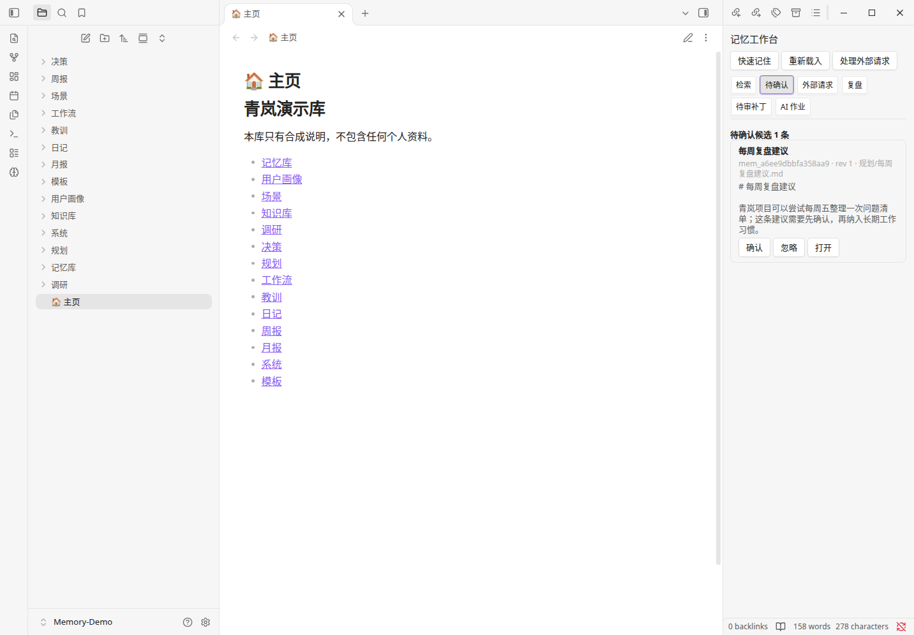

# Missher Obsidian Memory

[Missher 项目总入口](https://github.com/Missher12/Missher-DeepseekHarness-Desktop) · [全部插件目录](https://github.com/Missher12/Missher-DeepseekHarness-Desktop/blob/main/plugins/README.zh.md)

一个**独立的** Obsidian 第二大脑与 AI 记忆插件：记忆是你库里的普通 Markdown，
写不进去就不会假装写进去了。

- 记忆存在你自己的 Vault 里，是带元数据的 `.md` 文件，用任何编辑器都能看；
- 外部工具（CLI / MCP）默认**只排队**，真正的写入由插件用 `Vault.process` 完成；
- AI 是**可选**的：不配模型也能记、能搜、能复盘（本地确定性检查）；
- 不依赖 MSE、DSH、OpenViking 或任何云服务才能启动和使用。

需求编号 `OBS-MEM-20261009`。版本 `0.2.0`。源码与产品安装包按 MIT 许可证公开；个人 Vault、笔记、凭据和学习数据仍由用户自行保管，不进入本仓库。

---

## 界面预览

在 Obsidian 内打开“记忆工作台”，浏览待确认的记忆；确认、忽略或打开原文均在同一侧栏完成。



图为 `0.2.0` 的真实应用截图，使用完全虚构的“青岚演示库”，AI 已关闭。截图展示分类与工作台界面，不包含个人笔记，也不代表所有宿主版本均已验证。

## 30 秒看懂它解决什么问题

普通的「AI 记笔记」有两个坑：

1. **它说记住了，其实没写进去。** 模型回答「已记录」，磁盘上什么都没有。
2. **它覆盖了你刚手改的内容。** 你在 Obsidian 里改了两个字，外部工具照着旧内容写回去，
   你的修改静默消失。

这个插件对这两点的处理是：

| 问题 | 这里的做法 |
| --- | --- |
| 「已记录」到底是真是假 | 分两个词：`accepted`（请求已持久排队）≠ `completed`（真的写进去了）。只有 `.memory/receipts/` 里的回执写着 `completed` 才算数 |
| 覆盖人工编辑 | 提交时在**同步回调里**比较当前原文与期望哈希，不一致就**拒绝写入**并留下 `conflict` 回执，你的编辑完好 |
| AI 乱发内容 | 每条记忆有 `allow_model` 开关，只有「允许发送 + 已确认 + 未撤回 + 在有效期内」四条都满足才会进入模型上下文 |
| AI 花掉你的钱 | 模型调用有持久日预算（调用次数与 token 各一条上限），UTC 日界自动翻页 |

---

## 安装

### 1. 装插件

下载[最新正式版插件 ZIP 与 CLI 包](https://github.com/Missher12/Missher-Obsidian-Memory/releases/latest)，本次 0.2.0 分类说明见 [Missher 中文分类](docs/CLASSIFICATION.md)。源码构建的交付目录为 `dist/`；旧版 0.1.1 保留，其安装包不包含中文分类功能。

兼容维护以支持合理的 Obsidian 版本范围、持续适配最新版为目标。当前清单声明最低 Obsidian 1.5.0，仅用于桌面端；最低要求和测试记录分别说明，已测试版本不代表唯一可用版本。0.2.0 的离线检查与尚未完成的原生验收见[交付记录](docs/DELIVERY-0.2.0.md)。

从源码构建需要 Node ≥ 22.13 与 pnpm：

```bash
pnpm install
pnpm run build        # 产物在 dist/missher-obsidian-memory/
pnpm run package      # 额外产出 ZIP 与 SHA256SUMS.txt
```

然后把插件放进你的库：

```
<你的Vault>/.obsidian/plugins/missher-obsidian-memory/
    main.js
    manifest.json
    styles.css
```

也可以直接用 `dist/missher-obsidian-memory-0.2.0.zip` 解压得到这个目录。

在 Obsidian 里：`设置 → 第三方插件` → 关闭「受限模式」→ 启用 **Missher Obsidian Memory**。

> 想先拿一份假数据试试？见 [`examples/synthetic-vault/`](examples/synthetic-vault/)：
> 一个完全虚构的示例库，带一条**真实排队**的示例请求，复制出去就能用。

### 2. 想用命令行或 MCP（可选）

`pnpm run package` 会产出一个**不依赖本仓库**的独立包：

```bash
tar -xzf dist/mom-memory-cli-0.2.0.tgz
node mom-memory-cli/lib/cli.js help
```

也可以直接用仓库里的产物：

```bash
node packages/cli/dist/cli.js --vault /绝对路径/到/Vault queue-status
```

---

## 用法

0.2.0 新增 14 类纯中文目录绑定、短标题与重名保护，旧版默认目录保持兼容。
可选择专用根目录内分类，或接入 Vault 现有的分类文件夹；普通笔记不自动转成记忆。
见 [设置步骤与分类边界](docs/CLASSIFICATION.md)、[合成示例库](examples/missher-vault/README.md) 和 [MSE 互动方向](docs/MSE-INTERACTION.md)。

### 在 Obsidian 里

命令面板（`Cmd/Ctrl + P`）里搜 `Missher Obsidian Memory`：

| 命令 | 做什么 |
| --- | --- |
| 快速记住… | 写一条记忆（可勾选「先进待确认」只创建候选） |
| 记住选中的文字 | 把编辑器里选中的内容记下来 |
| 记住剪贴板内容 | 把剪贴板内容记下来 |
| 搜索记忆… | 检索，命中项可点开对应笔记 |
| 打开记忆工作台 | 侧栏面板：状态、待确认、队列、模型账目 |
| 处理外部写请求队列 | 立刻处理 CLI/MCP 排队的写请求 |
| 重建检索索引 | 索引是派生物，随时可重建 |
| 查看当前笔记的记忆详情 | 看元数据、来源、提交用的期望哈希 |
| 把当前笔记导出为 MSE 方法候选包 | **只本地生成**一个 JSON 到 `_exports/`，不发送 |
| 查看复盘建议详情… | 本地确定性检查发现的问题，逐条决定 |

### 命令行

下面每条都是**可以整行复制**的完整命令（不依赖 shell 变量，
所以 zsh / bash 下行为一致）。把 `VAULT` 换成你的库的绝对路径。

```bash
# 先设一次路径变量（zsh 与 bash 都支持）
VAULT=/绝对路径/到/Vault

# 记一件事（排队 → 插件提交后才是 completed）
node packages/cli/dist/cli.js remember --vault "$VAULT" --text "项目 Borealis 的构建脚本改用 pnpm 11。"

# 生成候选（默认 pending，需要你确认才成为权威事实）
node packages/cli/dist/cli.js propose --vault "$VAULT" --text "候选内容"

# 检索
node packages/cli/dist/cli.js search --vault "$VAULT" --text "构建脚本" --limit 5

# 看看队列里还有什么没处理
node packages/cli/dist/cli.js queue-status --vault "$VAULT"

# 更新（可以显式给定期望哈希；不给就现查当前值）
node packages/cli/dist/cli.js update --vault "$VAULT" --id mem_xxx --text "新内容"
node packages/cli/dist/cli.js update --vault "$VAULT" --id mem_xxx --text "新内容" --expected-hash <64位十六进制>

# 把一条记忆标记为「不发送给模型」（也可用于创建时：remember --no-allow-model true）
node packages/cli/dist/cli.js update --vault "$VAULT" --id mem_xxx --no-allow-model true --text "同一段正文"
```

> `$VAULT` 是**普通变量**，可以直接用；不要把命令写进一个字符串变量再调用
> （`CLI="node ...cli.js"; $CLI remember` 在 zsh 里不会按空格拆词，会报「找不到命令」）。

全部命令见 `node packages/cli/dist/cli.js help`。

**所有**命令都要 `--vault`：本产品不会去猜你的库在哪，也不会读你没指定的目录。

### MCP

```bash
node packages/cli/dist/mcp.js --vault "$VAULT"
```

MCP 与 CLI **同一份参数契约**：同样的范围语义、同样的「排队而不是直接写」、
同样的 `accepted` / `completed` 区分。

---

## 语义：几个必须分清的概念

| 词 | 含义 |
| --- | --- |
| `accepted` | 请求已**持久落盘**在 `.memory/requests/`。**不代表**记忆已经写入 |
| `completed` | 回执确认提交成功，带 revision 与落地证据（内容哈希，或永久删除的删除标记） |
| `conflict` | 提交时内容与期望值不一致（人工编辑/并发/过期版本）。请求**没有**生效 |
| `failed` | 提交者明确报告失败（校验不过、范围不允许等） |
| `expired` | 超过存活期（默认 7 天）未被处理。请求**留在盘上**，不自动重试、不自动删除 |
| `pending` | 记忆本身的状态：候选，等待你确认 |
| `confirmed` | 已确认的权威事实 |

`expired` 与 `failed` 不会被自动重做——宁可让你看到一条没处理的请求，
也不悄悄替你重做决定。

---

## 关于 AI（可选，默认关闭）

在 `设置 → Missher Obsidian Memory → AI` 里填 OpenAI 兼容的 `baseUrl`、模型名与密钥。
**默认 `enabled: false`**，不填就完全离线：记住、搜索、本地复盘都照常工作。

### 密钥放哪

- `secret-storage`：写进 Obsidian 的 `SecretStorage`（1.11.4+），不落进插件 `data.json`。
  **不声称**它一定使用系统钥匙串或一定加密——它取决于 Obsidian 自身实现。
- `session`：只保留在本次运行的插件内存里，关闭 Obsidian 即丢失。

### 花钱的上限

`dailyCallBudget`（每日调用次数，默认 200）与 `dailyTokenBudget`（每日 token，默认 200000）
是**持久**的、**共享**的：问答、提取、复盘三条路径共用同一份账，
按 **UTC 日**自动翻页。到达上限后请求**不会发出去**，界面会说明原因。

token 计数优先用提供方响应里的真实 `usage`；提供方不报用量时保留**保守估算**
并在账目里标明「估算」，不假装是实测值。

### 哪些内容会被发出去

一条记忆进入模型上下文需要同时满足：

1. `allow_model` 为 `true`；
2. 状态是 `confirmed`；
3. 未被撤回；
4. 在有效期内（`valid_until` 未过）；
5. 存储本身可操作（读盘故障时一条都不发）。

界面里能看到「哪些没被发送、为什么」（发送范围报告）。

---

---

## 历史验收状态（0.1.1，2026-10-09）

本表是旧版本证据，不代表 0.2.0 原生验收。当前交付见 [0.2.0 验证记录](docs/DELIVERY-0.2.0.md)。

| 层 | 状态 | 证据 |
| --- | --- | --- |
| 0.1.1 类型、逻辑、构建与包检查 | 本机通过 | 232 项测试、CLI 34 项、MCP 88 项；18/18 自检 |
| 冻结包独立核对 | 通过 | 8 组 48 项；真实 DSH MCP SDK 分发包 5 项 |
| macOS / Obsidian 1.14.4 真实进程 | 通过本轮所列场景 | 官方 CLI、实际插件、真实 Vault API 与界面 DOM；见[运行验收](docs/LIVE-ACCEPTANCE.md) |
| 物理鼠标键盘、真实远端模型、MSE 接收 | 未验证 | 不用程序化界面或离线结果替代 |

真实进程已验证记住、pending 隔离与界面确认、检索打开、CLI/MCP 排队后由插件提交、旧哈希冲突保护、Vault 事件索引刷新、本地复盘与忽略、遗忘退出召回。深浅主题下约束为 300 × 420 CSS 像素的工作台面板无横向溢出，空内容提示与程序化 Escape 取消通过；这不等于物理键鼠或整窗缩放验收。

测试在用户明确指定的新库内独立合成目录完成。结束后插件保持启用，日常根为 `Second Brain`，本地自动复盘恢复默认，未配置的 AI/MSE 均关闭。个人笔记只核对哈希，原文未读取用于验收。0.1.1 修复自动复盘开关未接入调度、本地维护错误占用模型预算的问题。真实进程补验确认关闭后不新建自动作业，开启后完成本地复盘并保留预算；同一轮调度不重复执行。0.1.0 发布与资产保留。

---

## 安全与边界（如实说明）

**设计上不做的事**

- 不使用任意文件系统 API 读写你的库：插件只用 Obsidian 的 Vault API。
- CLI/MCP 不做 `..`、绝对路径、符号链接逃逸；不能读写记忆根之外。
- 不把外部排队当成「已写入」；不自动重试、不自动清空失败请求。
- 不因为装了本插件就去动你的其他 Vault、其他应用或全局配置。
- MSE 联动默认关闭；「导出方法候选包」**只本地写文件**，不联网、不上传。

**明确没有验证的部分**（不当作已通过）

- **真实远端模型端点**：自动化测试打的是本地假端点。真实供应商的响应格式、
  超时与限流行为需要你在自己环境里试。
- **移动端**：首版定位为桌面产品，`manifest.json` 标了 `isDesktopOnly: true`，
  移动端不会被认为是受支持的目标，也**从未在移动端运行过**。
  移动端的 Obsidian API 与可用能力差异（包括凭据存储）我们**没有实测**，
  因此这里只陈述「首版限桌面、移动端未支持也未验证」，不推断移动端具体缺什么。
- **物理鼠标键盘与完整跨平台桌面交互**：未验证。本轮仅验证 macOS 上实际 Obsidian 进程中的程序化界面与存储行为，见上述验收状态。
- **MSE 端到端**：只做到「本地生成 + 本地按 `mse-method-v1` 校验」，
  没有与任何真实 MSE 实例通信，也没有声称会被 MSE 接收。
- **提示注入**：模型可能被笔记内容影响。护栏在「哪些内容允许进入上下文」这一层，
  不在「模型说了什么」这一层——不要把模型输出当权威事实。
- **多设备并发**：队列协议假设同一时刻有一个权威写入者（本机的 Obsidian）。
  多台设备同时写同一个库不在验证范围内。

---

## 接入方式

- DeepSeek Harness（Cordis loader 条目）：[`examples/dsh-cordis-memory.yml`](examples/dsh-cordis-memory.yml)
- 其他 MCP 客户端（`mcpServers` JSON）：[`examples/mcp-generic.json`](examples/mcp-generic.json)
- 只想先用命令行确认闭环：[`examples/cli-walkthrough.sh`](examples/cli-walkthrough.sh)

三个样例的说明与先决条件见 [`examples/README.md`](examples/README.md)。
样例里的路径都是占位符，要换成你自己的绝对路径。

## 开发

```bash
pnpm install
pnpm run typecheck     # core + plugin + cli
pnpm test              # vitest（单并发）
pnpm run build         # 产出插件 + CLI + MCP
pnpm run package       # ZIP / tgz / SHA256SUMS.txt
pnpm run verify        # 交付自检：构建、产物边界、类型、测试、e2e、校验和
pnpm run e2e:cli       # 外部 CLI 排队 → 真实插件代码提交 → 回执回读
pnpm run e2e:mcp       # MCP 与 CLI 同契约
pnpm run clean         # 清理构建产物（不碰你的 Vault）
```

`pnpm run verify` 只做**本仓库自检**。独立复核由协调者的
`verify-*-independent.*` 脚本在冻结候选上执行——被验收方自己跑自己的验收没有意义。
CI（[`.github/workflows/verify.yml`](.github/workflows/verify.yml)）跑的就是这套自检，
用 `--frozen-lockfile` 安装，不跑任何独立验收脚本。

- 仓库结构与设计取舍：[`docs/ARCHITECTURE.md`](docs/ARCHITECTURE.md)
- 阶段上下文（给接手的人）：[`PROJECT_CONTEXT.md`](PROJECT_CONTEXT.md)
- 交接、冻结校验和与未验证层：[`HANDOVER.md`](HANDOVER.md)
- 就绪清单（跑过的命令与真实结果）：[`READY.md`](READY.md)
- 接入样例：[`examples/`](examples/README.md)

## 许可

MIT，见 [`LICENSE`](LICENSE)。
